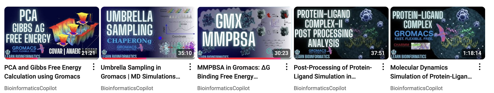

# Molecular Dynamics with GROMACS

A curated collection of ready-to-use scripts, SLURM templates, input bundles, and step-by-step guides for running and analyzing **Molecular Dynamics (MD)** simulations with **GROMACS** (plus a **LAMMPS** nanomaterial builder and **CHAPERON*g*** automation).



> **Video Tutorials:** Follow the complete [YouTube Playlist on Molecular Dynamics with GROMACS](https://www.youtube.com/playlist?list=PLS3KFDv2o0CQIvkKuL7kU2rfowWIfHFFN).

---

## Repository Map

```text
Molecular-Dynamics/
├── workflows/                 # Simulation setup guides, run scripts & input bundles
│   ├── protein-only/          #   Protein-in-water GROMACS script
│   ├── protein-ligand/        #   GROMOS96 (ATB/PRODRG) & CHARMM36 (CGenFF) guides
│   ├── lipid-bilayer/         #   Asymmetric plasma membrane inputs + SLURM & InflateGRO
│   └── nanomaterials/         #   CHARMM-GUI nanomaterial MD + LAMMPS fluid-on-layer builder
├── hpc/                       # Reusable SLURM job templates, batch scripts & NVIDIA GPU guide
│   └── nvidia-gpu/            #   NGC GROMACS container, GPU offload, multi-GPU, MPS & MIG
├── analysis/                  # Trajectory post-processing & downstream analysis
│   ├── post-processing/       #   PBC removal, centering, RMSD, snapshots, extending runs
│   ├── pca-fel-entropy/       #   Windowed PCA, Free Energy Landscape (FEL), entropy & slides
│   └── mmpbsa-gbsa/           #   gmx_MMPBSA input, Conda env, slides & example results
├── tools/                     # Bundled third-party automation tools
│   └── CHAPERONg/             #   CHAPERONg automated GROMACS pipeline
├── docs/                      # Reference Word/PDF protocols
└── assets/                    # Repository images
```

---

## Quick Script & Guide Finder

Looking for a specific task? Jump straight to the file you need:

| What do you want to do? | Where to go | Type |
| :--- | :--- | :--- |
| Run a **protein-only** GROMACS simulation locally | [`workflows/protein-only/run_protein_md.sh`](workflows/protein-only/run_protein_md.sh) | Bash script |
| Run a **protein-only** simulation on a **SLURM** cluster | [`hpc/slurm_protein_md.sh`](hpc/slurm_protein_md.sh) | SLURM script |
| Simulate a **protein–ligand** complex (GROMOS96 / ATB) | [`workflows/protein-ligand/gromos_protein_ligand_guide.md`](workflows/protein-ligand/gromos_protein_ligand_guide.md) | Guide |
| Simulate a **protein–ligand** complex (CHARMM36 / CGenFF on Tetralith) | [`workflows/protein-ligand/charmm_tetralith_guide.md`](workflows/protein-ligand/charmm_tetralith_guide.md) | Guide |
| Randomly **insert multiple ligands** into a solvated system | [`workflows/protein-ligand/charmm_random_ligand_insertion.md`](workflows/protein-ligand/charmm_random_ligand_insertion.md) | Guide |
| Run a **CHARMM-GUI** equilibration + production pipeline on SLURM | [`hpc/slurm_charmm_gui.csh`](hpc/slurm_charmm_gui.csh) | SLURM script |
| Run GROMACS with **NVIDIA NGC container**, full **GPU offload**, or **MPS/MIG** | [`hpc/nvidia-gpu/README.md`](hpc/nvidia-gpu/README.md) ([NGC runner](hpc/nvidia-gpu/run_ngc_gromacs.sh), [MPS runner](hpc/nvidia-gpu/run_mps_multidir.sh)) | Guide + Bash |
| Simulate an **asymmetric mammalian plasma membrane** | [`workflows/lipid-bilayer/`](workflows/lipid-bilayer/) | Inputs + SLURM |
| Embed a protein in a membrane with **InflateGRO** | [`workflows/lipid-bilayer/inflategro_membrane_protein.md`](workflows/lipid-bilayer/inflategro_membrane_protein.md) | Guide |
| Run **nanomaterial + ligand** MD in GROMACS | [`workflows/nanomaterials/charmm_nanomaterials_guide.md`](workflows/nanomaterials/charmm_nanomaterials_guide.md) | Guide |
| Build a **2D substrate + graphene + fluid** LAMMPS `system.data` | [`workflows/nanomaterials/build_fluid_on_layer.py`](workflows/nanomaterials/build_fluid_on_layer.py) ([notebook](workflows/nanomaterials/build_fluid_on_layer.ipynb)) | Python / Colab |
| Fix PBC, center, compute RMSD, extract frames, or extend runs | [`analysis/post-processing/README.md`](analysis/post-processing/README.md) | Cheat sheet |
| **Batch post-process** multiple simulation folders at once | [`hpc/batch_postprocess.sh`](hpc/batch_postprocess.sh) | Bash script |
| Run windowed **PCA & Free Energy Landscape (FEL)** analysis | [`analysis/pca-fel-entropy/run_pca_fel_windows.sh`](analysis/pca-fel-entropy/run_pca_fel_windows.sh) | Bash script |
| Compute **PCA & quasi-harmonic entropy** | [`analysis/pca-fel-entropy/README.md`](analysis/pca-fel-entropy/README.md) | Guide + Slides |
| Compute **MM-PBSA / MM-GBSA** binding free energy (`gmx_MMPBSA`) | [`analysis/mmpbsa-gbsa/README.md`](analysis/mmpbsa-gbsa/README.md) | Config + Env |
| Automate GROMACS MD & analysis with **CHAPERON*g*** | [`tools/CHAPERONg/README.md`](tools/CHAPERONg/README.md) | Bundled tool |
| Read printable **Word / PDF protocols** | [`docs/README.md`](docs/README.md) | Docs |

---

## Getting Started

### Prerequisites

- **GROMACS** (2019.2+ recommended for CHARMM-GUI inputs): see the [official installation guide](https://manual.gromacs.org/current/install-guide/index.html).
- **Python (optional, for analysis & nanomaterial building):**
  ```bash
  pip install numpy scipy matplotlib mdanalysis ase
  ```
- **Conda (optional, for `gmx_MMPBSA` or `CHAPERONg`):** see [`analysis/mmpbsa-gbsa/env.yml`](analysis/mmpbsa-gbsa/env.yml) and [`tools/CHAPERONg/conda_dependencies.yml`](tools/CHAPERONg/conda_dependencies.yml).

### Clone the Repository

```bash
git clone https://github.com/pritampanda15/Molecular-Dynamics.git
cd Molecular-Dynamics
```

### Quick GROMACS Reference

1. **Generate run input (`.tpr`):**
   ```bash
   gmx grompp -f simulation.mdp -c initial.gro -p topol.top -o simulation.tpr
   ```
2. **Run MD simulation:**
   ```bash
   gmx mdrun -v -deffnm simulation
   ```
3. **Simulation length cheat sheet** (with a `2 fs` integration time step):
   - `1 ns` = `500,000` steps
   - `10 ns` = `5,000,000` steps
   - `100 ns` = `50,000,000` steps

---

## Useful External Resources

- [YouTube Channel](https://youtu.be/hc8ZXbOMEfw) & [GROMACS MD Playlist](https://www.youtube.com/playlist?list=PLS3KFDv2o0CQIvkKuL7kU2rfowWIfHFFN)
- [GROMACS Official Documentation](https://manual.gromacs.org/)
- [NVIDIA NGC GROMACS Container](https://catalog.ngc.nvidia.com/orgs/hpc/-/containers/gromacs/-?_lr=1)
- [NVIDIA Blog: Creating Faster MD Simulations with GROMACS 2020](https://developer.nvidia.com/blog/creating-faster-molecular-dynamics-simulations-with-gromacs-2020/)
- [NVIDIA Blog: Maximizing GROMACS Throughput with MPS and MIG](https://developer.nvidia.com/blog/maximizing-gromacs-throughput-with-multiple-simulations-per-gpu-using-mps-and-mig/)
- [CHARMM-GUI](https://www.charmm-gui.org/)
- [SwissParam (Ligand Topology Generator)](http://www.swissparam.ch/)
- [Tieleman Lipid Coordinates](https://people.ucalgary.ca/~tieleman/download.html)
- [Nanotube Generator (TubeGen)](http://turin.nss.udel.edu/research/tubegenonline.html)
- [NPTEL Topology File Generation Notes](https://nptel.ac.in/courses/104101002/downloads/lecture-notes/module4/chapter35.pdf)
- [MD Tutorial with GROMACS](http://www.jyhuang.idv.tw/JYH_MDSimulation.html)

---

## Contributing

Contributions, bug fixes, and additional MD scripts are welcome!

1. Fork the repository and create a feature branch.
2. Add your script or guide in the appropriate directory (`workflows/`, `hpc/`, or `analysis/`) and update its folder `README.md`.
3. Open a pull request describing your changes.
