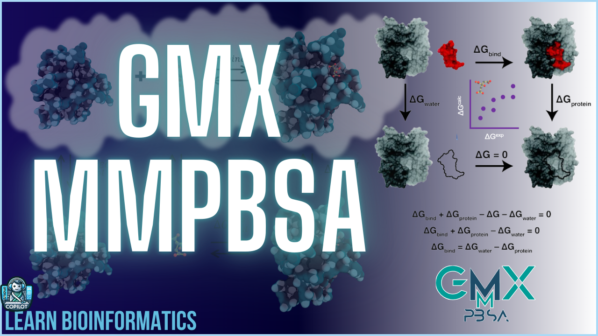

# Binding Free Energy Analysis with `gmx_MMPBSA` (MM-PBSA / MM-GBSA)

<p align="center">
  
</p>

Configuration, Conda environment specification, slides, and example outputs for estimating protein–ligand binding free energy using **gmx_MMPBSA**.

## Contents

- [`mmpbsa.in`](mmpbsa.in) — Input parameter file (AMBER GB `igb=5` model, frames 1–5000).
- [`env.yml`](env.yml) — Conda environment definition (`gmxMMPBSA`).
- [`Understanding-MMGBSA-Estimating-Binding-Free-Energy.pptx`](Understanding-MMGBSA-Estimating-Binding-Free-Energy.pptx) — Presentation slides on MM-GBSA theory and workflow.
- [`example-results/`](example-results/) — Sample output files (`FINAL_RESULTS_MMPBSA.dat`, `FINAL_RESULTS_MMPBSA.csv`, `gmx_MMPBSA.log`, `protein-ligand_Normal_GB_Delta.svg`).

---

## 1. Install `gmx_MMPBSA`

Create and activate the Conda environment:

```bash
conda env create -f env.yml
conda activate gmxMMPBSA
```

---

## 2. Run Binding Free Energy Analysis

Adjust the trajectory, TPR, index groups (`-cg <receptor_group> <ligand_group>`), and topology paths for your system:

```bash
gmx_MMPBSA -O \
    -i mmpbsa.in \
    -cs md_0_100.tpr \
    -ct md_0_100_fit.xtc \
    -ci index.ndx \
    -cg 1 13 \
    -cp topol.top \
    -o FINAL_RESULTS_MMPBSA.dat \
    -eo FINAL_RESULTS_MMPBSA.csv
```

---

## 3. Visualize & Inspect Results

Launch the interactive `gmx_MMPBSA_ana` GUI on the generated info file:

```bash
gmx_MMPBSA_ana -f _GMXMMPBSA_info
```
